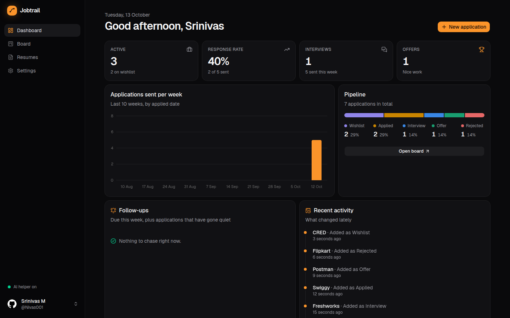
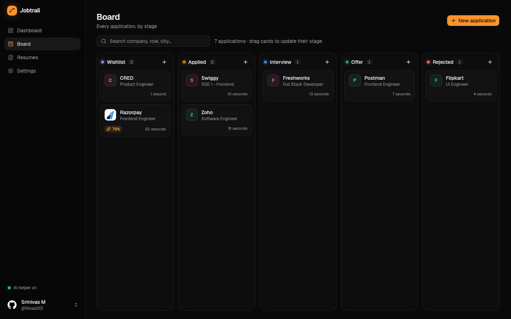
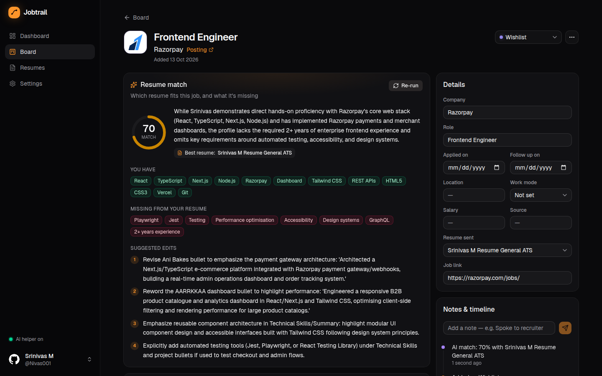
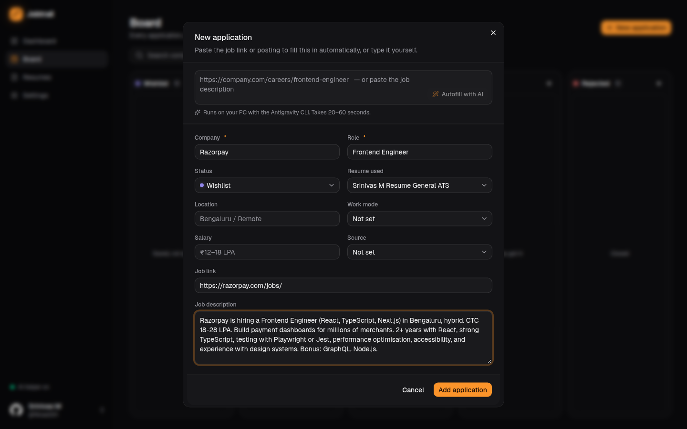
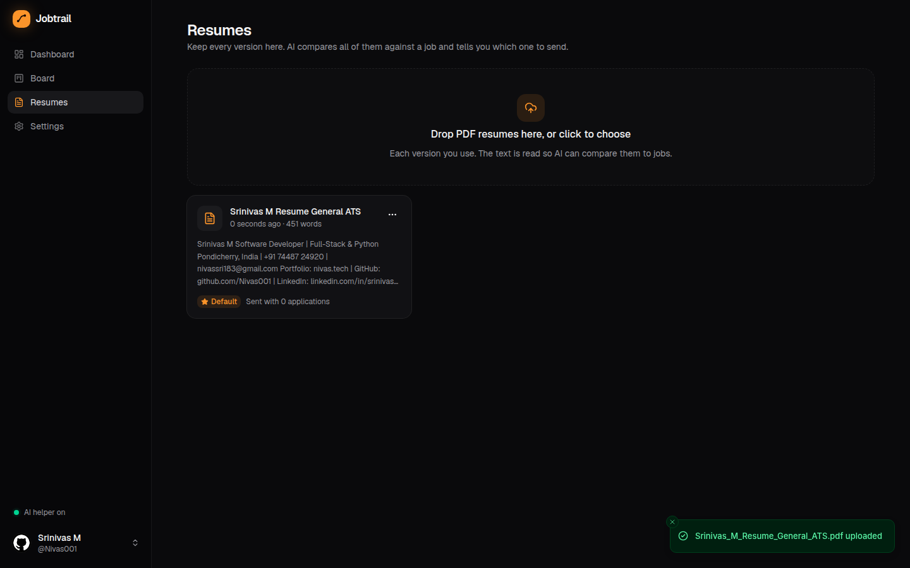

<div align="center">

# Jobtrail

**A job application tracker that tells you which resume to send — and writes the cover letter.**

Drag-and-drop pipeline · resume-to-job matching · AI cover letters · runs its AI on your own machine




</div>

## Why

Job hunting with several versions of a resume gets messy fast: which one did I send to whom, which one fits this posting, what is it missing, and did I ever follow up? Jobtrail keeps every application on one board and uses an AI assistant to answer those questions — without an API key, by driving the [Antigravity CLI](https://antigravity.google) that's already on your computer.

## Features

- **Pipeline board** — Wishlist → Applied → Interview → Offer → Rejected. Drag cards between stages; every move is logged to the application's timeline.
- **Paste a link, get a filled form** — drop in a job URL or the posting text and AI extracts company, role, location, work mode and salary.
- **Resume match** — compares *all* your resumes against the job, picks the best one, scores the fit (0–100), lists the keywords you have and the ones you're missing, and suggests concrete edits.
- **Cover letters** — drafted from your real resume for the specific role, in the tone you pick. Edit, save and copy.
- **Dashboard** — active applications, response rate, interviews, offers, applications per week, pipeline breakdown, follow-ups due and applications that have gone quiet.
- **Resume library** — upload PDF versions; text is extracted so AI can read them. Files live in a private bucket and are only served to you.
- **Private by default** — GitHub sign-in with an allowlist; every row and file carries owner-only permissions.
- Dark, keyboard-friendly UI that works on phones too.

| Board | Resume match |
| --- | --- |
|  |  |

| New application | Resumes |
| --- | --- |
|  |  |

## How the AI works

```
Browser (Jobtrail)  ──fetch──▶  helper on 127.0.0.1:4777  ──spawns──▶  agy -p … --json-schema …
        ▲                                │
        └──────── structured JSON ◀──────┘
```

`helper/server.mjs` is a ~250-line, dependency-free Node server that runs on your PC. It turns requests from the app into `agy --print --output-format json --json-schema …` calls, so every answer comes back as validated JSON. It:

- listens on `127.0.0.1` only, and answers only the origins listed in `JOBTRAIL_ORIGINS` (with the `Access-Control-Allow-Private-Network` header Chrome needs for https → localhost);
- runs each call in an empty temporary workspace and asks the model not to use tools;
- refuses local-network URLs when fetching job postings.

When the helper isn't reachable (e.g. you open Jobtrail on your phone), AI buttons are disabled and everything else keeps working.

## Tech stack

| | |
| --- | --- |
| Framework | Next.js 16 (App Router, Server Actions, `proxy.ts`), React 19, TypeScript |
| UI | Tailwind CSS 4, shadcn/ui (Radix), dnd-kit, Recharts, lucide |
| Backend | Appwrite — Auth (GitHub OAuth, SSR sessions), TablesDB, Storage |
| PDF text | unpdf |
| AI | Antigravity CLI (`agy`) through the local helper |

## Getting started

### 1. Install

```bash
git clone https://github.com/Nivas001/jobtrail.git
cd jobtrail
pnpm install
cp .env.example .env.local
```

### 2. Appwrite

1. Create a project on [Appwrite Cloud](https://cloud.appwrite.io) and put its endpoint and project ID in `.env.local`.
2. Create an **API key** with *Auth*, *Database* and *Storage* scopes → `APPWRITE_API_KEY`.
3. Add a **Web platform** for every hostname you'll use (`localhost`, your Vercel domain).
4. Create the database, tables, indexes and the resume bucket:
   ```bash
   pnpm setup:appwrite
   ```
   The script is idempotent — re-run it any time.

### 3. GitHub sign-in

1. Create a [GitHub OAuth app](https://github.com/settings/developers). Callback URL:
   `https://<region>.cloud.appwrite.io/v1/account/sessions/oauth2/callback/github/<project-id>`
2. In Appwrite → **Auth → Settings → GitHub**, paste the client ID and secret and enable it.
3. Set `ALLOWED_GITHUB_LOGINS` to your GitHub username.

### 4. Run

```bash
pnpm dev
```

Open <http://localhost:3000>.

### 5. AI helper (optional)

Requires the [Antigravity CLI](https://antigravity.google) (`agy`) signed in on the same machine.

```bash
mkdir -p ~/.config/jobtrail
cp helper/helper.env.example ~/.config/jobtrail/helper.env   # set JOBTRAIL_ORIGINS
pnpm helper                                                 # or run it as a service ↓
```

To keep it running in the background on Linux, copy `helper/jobtrail-helper.service` to `~/.config/systemd/user/`, fix the path, and run `systemctl --user enable --now jobtrail-helper`. The sidebar shows **AI helper on** when it's reachable.

## Deploying

Deploy to Vercel (or any Node host) with the same environment variables as `.env.local`. Then add the deployment's hostname as an Appwrite Web platform and to `JOBTRAIL_ORIGINS` in the helper's config, so AI works on the live site from your computer.

## Project structure

```
src/
  app/
    (app)/            dashboard, board, applications/[id], resumes, settings
    actions.ts        server actions (all writes go through the user's session)
    auth/callback/    OAuth → session cookie, GitHub allowlist
    api/resumes/[id]  streams a resume PDF with the user's own permissions
    login/
  components/         board, AI panels, dashboard charts, shadcn/ui
  lib/
    appwrite.ts       session + admin clients
    data.ts           server-side reads
    ai-helper.ts      browser → local helper
  proxy.ts            redirects signed-out visitors to /login
helper/               local AI helper + systemd unit
scripts/              setup-appwrite.mjs
```

---

Built by [Srinivas M](https://nivas.tech).
